# ENTITY RELATIONSHIP DIAGRAM (ERD) & DATABASE BLUEPRINT
## TRAZYL B2B — Bursa Bahan Baku Sekunder & Scrap Industri Indonesia

**Document Version:** 3.0.0 (Master Production Database Schema)  
**Database Engine Target:** PostgreSQL 16+ (or Google Cloud SQL for PostgreSQL)  
**Extensions Required:** `uuid-ossp`, `pgcrypto`, `postgis` (untuk kalkulasi radius logistik geospasial)  
**Data Standards:** ISO 8601 (Timestamp UTC), ISO 4217 (`IDR` / `USD`), ISRI Standard Scrap Specifications, OSS RBA Indonesia  

---

## 1. Visual Entity Relationship Diagram (Mermaid.js)

```mermaid
erDiagram
    COMPANIES ||--o{ USERS : "memiliki karyawan/PIC"
    COMPANIES ||--o| COMPANY_LEGAL_VERIFICATIONS : "mengajukan verifikasi NIB/NPWP/IUI"
    COMPANIES ||--o{ COMPANY_BANK_ACCOUNTS : "memiliki rekening pencairan"
    COMPANIES ||--o{ COMPANY_DELIVERY_ADDRESSES : "memiliki alamat gudang/pabrik"
    COMPANIES ||--o| COMPANY_TRAZYL_SCORES : "memiliki profil skor reputasi"
    COMPANIES ||--o| ESCROW_WALLETS : "memiliki akun saldo escrow"
    COMPANIES ||--o{ ESCROW_DEPOSITS : "melakukan topup dana deposit"
    COMPANIES ||--o{ ESCROW_WITHDRAWALS : "mengajukan penarikan dana"
    COMPANIES ||--o{ LISTINGS : "menjual scrap (Seller)"
    COMPANIES ||--o{ RFQ_REQUIREMENTS : "menerbitkan tender pabrik (Buyer)"
    COMPANIES ||--o{ RFQ_RESPONSES : "mengirim penawaran parsial (Seller)"
    COMPANIES ||--o{ AUCTION_BIDS : "menawar lelang (Buyer)"
    COMPANIES ||--o{ ORDERS_SELLER : "menjual dalam pesanan"
    COMPANIES ||--o{ ORDERS_BUYER : "membeli dalam pesanan"
    COMPANIES ||--o{ PROCUREMENT_PROJECTS : "membuat proyek pengadaan"
    COMPANIES ||--o{ SUPPLY_POOLS : "mengumpulkan stok agregat"
    COMPANIES ||--o{ FACTORY_CLEARANCE_PROJECTS : "melikuidasi aset pabrik"

    CATEGORIES ||--o{ SUBCATEGORIES : "memiliki subkategori"
    CATEGORIES ||--o{ LISTINGS : "mengelompokkan lot jual"
    CATEGORIES ||--o{ RFQ_REQUIREMENTS : "mengelompokkan tender"
    CATEGORIES ||--o{ PRICE_INDICES : "memiliki acuan harga"

    LISTINGS ||--o{ LISTING_PHOTOS : "memiliki galeri foto gudang"
    LISTINGS ||--o{ LISTING_SPECIFICATIONS : "memiliki atribut teknis ISRI"
    LISTINGS ||--o{ LISTING_DOCUMENTS : "memiliki berkas sertifikat COA"
    LISTINGS ||--o{ AUCTION_BIDS : "menerima penawaran lelang"
    LISTINGS ||--o{ NEGOTIATIONS : "menjadi objek sesi tawar-menawar"
    LISTINGS ||--o{ ORDERS : "dikonversi menjadi transaksi"

    NEGOTIATIONS ||--o{ NEGOTIATION_MESSAGES : "memuat riwayat pesan & tawaran"

    RFQ_REQUIREMENTS ||--o{ RFQ_RESPONSES : "menerima respon penawaran"
    RFQ_REQUIREMENTS ||--o{ SPLIT_ORDER_ALLOCATIONS : "dibagi menjadi kuota pasokan"
    SPLIT_ORDER_ALLOCATIONS ||--o| ORDERS : "menghasilkan kontrak pesanan resmi"

    PROCUREMENT_PROJECTS ||--o{ PROCUREMENT_PROJECT_ITEMS : "memiliki daftar material"
    PROCUREMENT_PROJECT_ITEMS ||--o{ PROCUREMENT_MATCHED_SUPPLIERS : "dicocokkan dengan supplier"

    SUPPLY_POOLS ||--o{ SUPPLY_POOL_MATCHED_DEMANDS : "dialokasikan ke pabrik pencari"

    FACTORY_CLEARANCE_PROJECTS ||--o{ FACTORY_CLEARANCE_ASSETS : "memiliki unit mesin/lot scrap"

    ORDERS ||--|| ORDER_PICKUP_LOGISTICS : "memiliki data armada & jadwal muat"
    ORDERS ||--o{ DELIVERY_ORDERS : "menerbitkan surat jalan pengiriman (DO)"
    ORDERS ||--o| WEIGHBRIDGE_TICKETS : "diverifikasi jembatan timbang resmi"
    ORDERS ||--o| QC_INSPECTIONS : "diuji kadar kemurnian & kontaminasi"
    ORDERS ||--|| SETTLEMENT_RECONCILIATIONS : "dihitung pelunasan true-up delta"
    ORDERS ||--o| ORDER_INVOICES : "memiliki faktur pajak & tagihan resmi"
    ORDERS ||--o| DIGITAL_DOCKETS : "menerbitkan surat jalan digital ber-QR"
    ORDERS ||--o| MATERIAL_PASSPORTS : "memiliki paspor sirkularitas & ESG"
    ORDERS ||--o{ DISPUTES : "berpotensi mengalami sengketa"

    DIGITAL_DOCKETS ||--o{ CHAIN_OF_CUSTODY_EVENTS : "mencatat pos pemantauan muatan"

    ESCROW_WALLETS ||--o{ ESCROW_LEDGER_ENTRIES : "mencatat mutasi debit/kredit double-entry"

    DISPUTES ||--o{ DISPUTE_EVIDENCES : "memiliki lampiran bukti foto/dokumen"

    PRICE_INDICES ||--o{ PRICE_INDEX_HISTORIES : "merekam riwayat harga harian"
```



---

## 2. Kamus Data & Spesifikasi Tabel Relasional (*Complete Data Dictionary*)

---

### DOMAIN 1: Entitas, Identitas, Legalitas & Rekening Perbankan

#### 1. Tabel: `companies`
Entitas bisnis utama pengelola depo scrap, pedagang besar komoditas, smelter peleburan, atau pabrik manufaktur.

| Kolom | Tipe Data | Nullable | Default | Batasan & Deskripsi Bisnis |
| :--- | :--- | :---: | :--- | :--- |
| `id` | `UUID` | **NO** | `uuid_generate_v4()` | **PRIMARY KEY**. ID unik perusahaan. |
| `company_name` | `VARCHAR(255)` | **NO** | - | Nama resmi entitas/depo (e.g. `'PT Cilegon Precision Steel'`). |
| `brand_name` | `VARCHAR(150)` | YES | `NULL` | Nama merek dagang / nama populer depo di pasar. |
| `legal_entity_type` | `VARCHAR(50)` | **NO** | `'PT'` | `'PT'`, `'CV'`, `'UD'`, `'Koperasi'`, `'Perorangan'`. |
| `business_type` | `VARCHAR(100)` | **NO** | - | `'Depo Pengumpul'`, `'Smelter Peleburan Baja'`, `'Pabrik Remelting Aluminium'`, `'Recycler Plastik'`. |
| `consumption_capacity_mt_month` | `DECIMAL(12, 2)` | YES | `0.00` | Kapasitas konsumsi/pasokan scrap per bulan (MT). |
| `description` | `TEXT` | YES | `NULL` | Profil profil fasilitas pabrik, alat uji lab, dan jembatan timbang. |
| `email_company` | `VARCHAR(150)` | **NO** | - | Email resmi korespondensi pengadaan (**UNIQUE**). |
| `phone_office` | `VARCHAR(30)` | YES | `NULL` | Telepon kantor / hunting. |
| `address_facility` | `TEXT` | **NO** | - | Alamat fisik fasilitas/gudang untuk pemuatan & pembongkaran. |
| `city` | `VARCHAR(100)` | **NO** | - | Kota/Kabupaten (e.g. Cilegon, Karawang, Surabaya). |
| `province` | `VARCHAR(100)` | **NO** | - | Provinsi fasilitas. |
| `postal_code` | `VARCHAR(10)` | YES | `NULL` | Kode pos lokasi. |
| `geo_latitude` | `DECIMAL(10, 7)` | YES | `NULL` | Titik koordinat GPS lintang untuk kalkulasi freight otomatis. |
| `geo_longitude` | `DECIMAL(10, 7)` | YES | `NULL` | Titik koordinat GPS bujur. |
| `logo_url` | `TEXT` | YES | `NULL` | URL logo perusahaan pada Cloud Storage. |
| `rating_score` | `DECIMAL(3, 2)` | **NO** | `5.00` | Nilai reputasi akumulatif (skala 1.00 - 5.00). |
| `completed_tx_count` | `INTEGER` | **NO** | `0` | Jumlah transaksi selesai tanpa sengketa. |
| `total_tonnage_handled`| `DECIMAL(14, 3)` | **NO** | `0.000` | Akumulasi tonase scrap yang telah diperdagangkan (MT). |
| `is_verified_seller` | `BOOLEAN` | **NO** | `TRUE` | Hak pasang iklan & jual stok scrap (**Aktif default**). |
| `is_verified_buyer` | `BOOLEAN` | **NO** | `FALSE` | Dibuka setelah lolos verifikasi berkas legalitas NIB/NPWP. |
| `created_at` | `TIMESTAMPTZ` | **NO** | `NOW()` | Waktu registrasi profil perusahaan. |
| `updated_at` | `TIMESTAMPTZ` | **NO** | `NOW()` | Waktu pembaruan profil terakhir. |

---

#### 2. Tabel: `users`
Akun penanggung jawab (PIC) atau staf yang mewakili perusahaan dalam transaksi.

| Kolom | Tipe Data | Nullable | Default | Batasan & Deskripsi Bisnis |
| :--- | :--- | :---: | :--- | :--- |
| `id` | `UUID` | **NO** | `uuid_generate_v4()` | **PRIMARY KEY**. ID pengguna. |
| `company_id` | `UUID` | **NO** | - | **FOREIGN KEY** ke `companies(id)` (ON DELETE RESTRICT). |
| `full_name` | `VARCHAR(150)` | **NO** | - | Nama lengkap penanggung jawab (PIC). |
| `email` | `VARCHAR(150)` | **NO** | - | Email login (**UNIQUE**, B-tree Indexed). |
| `password_hash` | `VARCHAR(255)` | YES | `NULL` | Argon2id/Bcrypt hash (opsional jika Google OAuth). |
| `phone_mobile` | `VARCHAR(30)` | **NO** | - | Nomor WhatsApp aktif untuk verifikasi OTP & notifikasi darurat. |
| `role` | `VARCHAR(50)` | **NO** | `'customer'` | `'customer'`, `'superadmin'`, `'escrow_officer'`, `'surveyor_qc'`. |
| `is_google_auth` | `BOOLEAN` | **NO** | `FALSE` | Apakah menggunakan otentikasi Google Workspace. |
| `avatar_url` | `TEXT` | YES | `NULL` | URL avatar foto profil pengguna. |
| `is_active` | `BOOLEAN` | **NO** | `TRUE` | Status aktif akun. |
| `last_login_at` | `TIMESTAMPTZ` | YES | `NULL` | Waktu sesi login terakhir. |
| `created_at` | `TIMESTAMPTZ` | **NO** | `NOW()` | Waktu pembuatan akun pengguna. |

---

#### 3. Tabel: `company_legal_verifications`
Berkas legalitas perusahaan untuk membuka hak akses pembeli pabrik (*Verified Buyer*).

| Kolom | Tipe Data | Nullable | Default | Batasan & Deskripsi Bisnis |
| :--- | :--- | :---: | :--- | :--- |
| `id` | `UUID` | **NO** | `uuid_generate_v4()` | **PRIMARY KEY**. |
| `company_id` | `UUID` | **NO** | - | **FOREIGN KEY** ke `companies(id)` (**UNIQUE, 1-to-1**). |
| `nib_number` | `VARCHAR(50)` | **NO** | - | Nomor Induk Berusaha (13 digit format OSS RBA). |
| `npwp_number` | `VARCHAR(50)` | **NO** | - | Nomor Pokok Wajib Pajak Badan (16 digit format baru DJP). |
| `company_legal_name`| `VARCHAR(255)` | **NO** | - | Nama resmi wajib pajak sesuai dokumen Kemenkeu/DJP. |
| `iui_number` | `VARCHAR(100)` | YES | `NULL` | Nomor Izin Usaha Industri dari Kemenperin RI. |
| `kemenkumham_sk` | `VARCHAR(100)` | YES | `NULL` | Nomor SK Pengesahan Badan Hukum dari Ditjen AHU Kemenkumham. |
| `weighbridge_cert_number` | `VARCHAR(100)` | YES | `NULL` | Nomor Sertifikat Tera Metrologi Legal jembatan timbang pembeli. |
| `weighbridge_capacity_ton` | `INTEGER` | YES | `60` | Kapasitas timbangan terkalibrasi pabrik (ton). |
| `nib_document_url` | `TEXT` | **NO** | - | URL berkas PDF NIB resmi. |
| `npwp_document_url`| `TEXT` | **NO** | - | URL berkas PDF NPWP perusahaan. |
| `verification_status`| `VARCHAR(30)` | **NO** | `'PENDING'` | `'UNVERIFIED'`, `'PENDING'`, `'VERIFIED'`, `'REJECTED'`. |
| `rejection_reason` | `TEXT` | YES | `NULL` | Alasan penolakan jika berkas ditolak Superadmin. |
| `verified_by_user_id`| `UUID` | YES | `NULL` | **FOREIGN KEY** ke `users(id)` admin verifikator. |
| `submitted_at` | `TIMESTAMPTZ` | **NO** | `NOW()` | Waktu pengajuan berkas. |
| `verified_at` | `TIMESTAMPTZ` | YES | `NULL` | Waktu keputusan verifikasi diterbitkan. |

---

#### 4. Tabel: `company_bank_accounts`
Rekening bank resmi perusahaan untuk pencairan hasil penjualan scrap (*Seller Disbursement*).

| Kolom | Tipe Data | Nullable | Default | Batasan & Deskripsi Bisnis |
| :--- | :--- | :---: | :--- | :--- |
| `id` | `UUID` | **NO** | `uuid_generate_v4()` | **PRIMARY KEY**. |
| `company_id` | `UUID` | **NO** | - | **FOREIGN KEY** ke `companies(id)`. |
| `bank_name` | `VARCHAR(100)` | **NO** | - | `'BCA'`, `'Mandiri'`, `'BNI'`, `'BRI'`, `'CIMB Niaga'`. |
| `bank_branch` | `VARCHAR(100)` | YES | `NULL` | Nama kantor cabang bank pembuka. |
| `account_number` | `VARCHAR(50)` | **NO** | - | Nomor rekening resmi perusahaan. |
| `account_holder_name`| `VARCHAR(150)` | **NO** | - | Nama pemilik rekening (Wajib sesuai NIB/NPWP). |
| `is_primary` | `BOOLEAN` | **NO** | `TRUE` | Apakah rekening utama pencairan escrow. |
| `is_verified` | `BOOLEAN` | **NO** | `TRUE` | Status validasi rekening oleh perbankan. |
| `created_at` | `TIMESTAMPTZ` | **NO** | `NOW()` | Waktu pendaftaran rekening. |

---

#### 5. Tabel: `company_delivery_addresses`
Daftar gerbang fasilitas pabrik/gudang pembeli sebagai titik bongkar muatan.

| Kolom | Tipe Data | Nullable | Default | Batasan & Deskripsi Bisnis |
| :--- | :--- | :---: | :--- | :--- |
| `id` | `UUID` | **NO** | `uuid_generate_v4()` | **PRIMARY KEY**. |
| `company_id` | `UUID` | **NO** | - | **FOREIGN KEY** ke `companies(id)`. |
| `facility_label` | `VARCHAR(100)` | **NO** | `'Pabrik Utama'` | Label fasilitas (e.g. `'Smelter Gate 2 Krakatau'`). |
| `pic_name` | `VARCHAR(150)` | **NO** | - | Nama petugas penerima logistik di gerbang pabrik. |
| `pic_phone` | `VARCHAR(30)` | **NO** | - | Nomor telepon petugas lapangan. |
| `full_address` | `TEXT` | **NO** | - | Alamat lengkap gerbang masuk truk. |
| `city` | `VARCHAR(100)` | **NO** | - | Kota lokasi. |
| `province` | `VARCHAR(100)` | **NO** | - | Provinsi lokasi. |
| `postal_code` | `VARCHAR(10)` | YES | `NULL` | Kode pos. |
| `weighbridge_station_name` | `VARCHAR(150)` | YES | `NULL` | Nama pos jembatan timbang di gerbang masuk. |
| `is_default` | `BOOLEAN` | **NO** | `FALSE` | Alamat pengiriman utama saat checkout. |
| `created_at` | `TIMESTAMPTZ` | **NO** | `NOW()` | Waktu penambahan alamat. |

---

#### 6. Tabel: `company_trazyl_scores`
Profil metrik skor keandalan (*TRAZYL Reliability Score*) untuk evaluasi otomatis algoritma tender.

| Kolom | Tipe Data | Nullable | Default | Batasan & Deskripsi Bisnis |
| :--- | :--- | :---: | :--- | :--- |
| `id` | `UUID` | **NO** | `uuid_generate_v4()` | **PRIMARY KEY**. |
| `company_id` | `UUID` | **NO** | - | **FOREIGN KEY** ke `companies(id)` (**UNIQUE, 1-to-1**). |
| `overall_score` | `DECIMAL(5, 2)` | **NO** | `95.00` | Skor total keandalan (0 - 100). |
| `on_time_delivery_pct` | `DECIMAL(5, 2)`| **NO** | `98.00` | Persentase ketepatan jadwal armada logistik. |
| `quantity_accuracy_pct` | `DECIMAL(5, 2)`| **NO** | `99.10` | Akurasi kesesuaian tonase awal vs timbangan jembatan. |
| `quality_consistency_pct`| `DECIMAL(5, 2)`| **NO** | `96.50` | Konsistensi kadar kemurnian uji lab. |
| `response_rate_pct` | `DECIMAL(5, 2)`| **NO** | `92.00` | Kecepatan merespon pesan negosiasi & tender. |
| `payment_reliability_pct`| `DECIMAL(5, 2)`| **NO** | `100.00` | Kecepatan pembeli mendanai escrow H+0 PO. |
| `dispute_speed_hours` | `DECIMAL(6, 2)` | **NO** | `4.50` | Rata-rata jam penyelesaian sengketa. |
| `updated_at` | `TIMESTAMPTZ` | **NO** | `NOW()` | Waktu kalkulasi ulang skor terakhir. |

---

### DOMAIN 2: Master Kategori & Standar Mutu Komoditas

#### 7. Tabel: `categories`
Kategori utama komoditas sekunder industri.

| Kolom | Tipe Data | Nullable | Default | Batasan & Deskripsi Bisnis |
| :--- | :--- | :---: | :--- | :--- |
| `id` | `VARCHAR(50)` | **NO** | - | **PRIMARY KEY** (e.g. `'ferrous'`, `'copper'`, `'aluminum'`). |
| `name` | `VARCHAR(100)` | **NO** | - | Nama kategori (e.g. `'Besi & Baja'`, `'Tembaga & Kuningan'`). |
| `isri_code_reference` | `VARCHAR(100)` | YES | `NULL` | Standar acuan ISRI (e.g. `'ISRI 200 - HMS 1'`). |
| `icon_symbol` | `VARCHAR(20)` | YES | `NULL` | Simbol emoji/icon visual antarmuka. |
| `display_order` | `INTEGER` | **NO** | `0` | Urutan tampilan pada navbar/katalog. |
| `is_active` | `BOOLEAN` | **NO** | `TRUE` | Status aktif kategori. |

---

#### 8. Tabel: `subcategories`
Subkategori spesifik material scrap.

| Kolom | Tipe Data | Nullable | Default | Batasan & Deskripsi Bisnis |
| :--- | :--- | :---: | :--- | :--- |
| `id` | `VARCHAR(50)` | **NO** | - | **PRIMARY KEY** (e.g. `'hms1'`, `'millberry'`, `'ubc_can'`). |
| `category_id` | `VARCHAR(50)` | **NO** | - | **FOREIGN KEY** ke `categories(id)`. |
| `name` | `VARCHAR(100)` | **NO** | - | Label subkategori (e.g. `'Tembaga Super Millberry Wire'`). |
| `default_unit` | `VARCHAR(20)` | **NO** | `'MT'` | Satuan kuantitas umum (`'MT'` / `'KG'`). |
| `min_thickness_mm` | `DECIMAL(6, 2)` | YES | `NULL` | Standar minimal ketebalan material jika ada. |
| `is_active` | `BOOLEAN` | **NO** | `TRUE` | Status aktif subkategori. |

---

### DOMAIN 3: Katalog Stok, Spesifikasi & Lelang Kilat

#### 9. Tabel: `listings`
Stok scrap yang dipasang oleh depo penjual (*Ready Stock* atau *Lelang Kilat*).

| Kolom | Tipe Data | Nullable | Default | Batasan & Deskripsi Bisnis |
| :--- | :--- | :---: | :--- | :--- |
| `id` | `VARCHAR(30)` | **NO** | - | **PRIMARY KEY** (e.g. `'LIST-1001'`). |
| `seller_company_id` | `UUID` | **NO** | - | **FOREIGN KEY** ke `companies(id)`. |
| `category_id` | `VARCHAR(50)` | **NO** | - | **FOREIGN KEY** ke `categories(id)`. |
| `subcategory_id` | `VARCHAR(50)` | YES | `NULL` | **FOREIGN KEY** ke `subcategories(id)`. |
| `title` | `VARCHAR(255)` | **NO** | - | Judul iklan scrap industri. |
| `description` | `TEXT` | YES | `NULL` | Uraian fisik material, asal pabrik, dan kebersihan stok. |
| `listing_type` | `VARCHAR(30)` | **NO** | `'FIXED_PRICE'`| `'FIXED_PRICE'`, `'AUCTION'`, `'FREE_PICKUP'`. |
| `condition` | `VARCHAR(50)` | **NO** | `'Processed'` | `'Clean'`, `'Processed'`, `'Unprocessed'`, `'Contaminated'`, `'Mixed'`. |
| `quantity` | `DECIMAL(12, 3)` | **NO** | - | Total tonase/volume barang siap muat (**CHECK > 0**). |
| `unit` | `VARCHAR(20)` | **NO** | `'MT'` | `'MT'`, `'KG'`, `'Piece'`, `'Lot'`. |
| `price_per_unit` | `DECIMAL(15, 2)` | **NO** | - | Harga penawaran per satuan dalam IDR (**CHECK >= 0**). |
| `currency` | `VARCHAR(10)` | **NO** | `'IDR'` | Mata uang resmi (`'IDR'`). |
| `total_price` | `DECIMAL(18, 2)` | **NO** | - | Total nilai lot (`price_per_unit * quantity`). |
| `incoterm` | `VARCHAR(10)` | **NO** | `'EXW'` | `'EXW'`, `'FOB'`, `'CIF'`, `'DDP'`. |
| `location_city` | `VARCHAR(100)` | **NO** | - | Kota penyimpanan stok fisik. |
| `location_address` | `TEXT` | **NO** | - | Alamat gudang/depo muat armada. |
| `port_of_loading` | `VARCHAR(150)` | YES | `NULL` | Pelabuhan muat jika Incoterm FOB/CIF. |
| `min_order_qty` | `DECIMAL(12, 3)` | **NO** | `1.000` | Minimal tonase pembelian parsial. |
| `status` | `VARCHAR(30)` | **NO** | `'Published'` | `'Draft'`, `'Pending Review'`, `'Published'`, `'Paused'`, `'Sold'`, `'Expired'`. |
| `current_bid` | `DECIMAL(15, 2)` | YES | `NULL` | Nilai tawaran tertinggi saat ini (khusus AUCTION). |
| `min_asking_price` | `DECIMAL(15, 2)` | YES | `NULL` | Harga penawaran pembuka lelang. |
| `bid_increment` | `DECIMAL(15, 2)` | YES | `NULL` | Kenaikan tawaran minimal lelang. |
| `bid_count` | `INTEGER` | **NO** | `0` | Akumulasi jumlah bid masuk. |
| `closing_date` | `TIMESTAMPTZ` | YES | `NULL` | Waktu penutupan lelang kilat. |
| `views_count` | `INTEGER` | **NO** | `0` | Total kali iklan dilihat pengguna. |
| `created_at` | `TIMESTAMPTZ` | **NO** | `NOW()` | Waktu penerbitan iklan. |
| `updated_at` | `TIMESTAMPTZ` | **NO** | `NOW()` | Waktu perubahan data terakhir. |

---

#### 10. Tabel: `listing_specifications`
Atribut spesifikasi teknis dinamis dari material scrap (Ketebalan, ISRI Code, Dimensi, Purity).

| Kolom | Tipe Data | Nullable | Default | Batasan & Deskripsi Bisnis |
| :--- | :--- | :---: | :--- | :--- |
| `id` | `UUID` | **NO** | `uuid_generate_v4()` | **PRIMARY KEY**. |
| `listing_id` | `VARCHAR(30)` | **NO** | - | **FOREIGN KEY** ke `listings(id)` (ON DELETE CASCADE). |
| `spec_key` | `VARCHAR(100)` | **NO** | - | Nama parameter (e.g. `'Kode ISRI'`, `'Ketebalan'`, `'Dimensi'`). |
| `spec_value` | `VARCHAR(255)` | **NO** | - | Nilai parameter (e.g. `'200 (HMS 1)'`, `'Min 6mm'`). |

---

#### 11. Tabel: `listing_photos`
Galeri foto dokumentasi riil stok di depo/lapangan.

| Kolom | Tipe Data | Nullable | Default | Batasan & Deskripsi Bisnis |
| :--- | :--- | :---: | :--- | :--- |
| `id` | `UUID` | **NO** | `uuid_generate_v4()` | **PRIMARY KEY**. |
| `listing_id` | `VARCHAR(30)` | **NO** | - | **FOREIGN KEY** ke `listings(id)` (ON DELETE CASCADE). |
| `photo_url` | `TEXT` | **NO** | - | URL berkas foto resolusi tinggi di CDN/Cloud Storage. |
| `caption` | `VARCHAR(255)` | YES | `NULL` | Keterangan foto (e.g. `'Tumpukan Scrap Yard Cilegon'`). |
| `is_primary` | `BOOLEAN` | **NO** | `FALSE` | Foto sampul utama katalog. |
| `display_order` | `INTEGER` | **NO** | `0` | Urutan penataan foto. |

---

#### 12. Tabel: `listing_documents`
Berkas lampiran penunjang (Certificate of Analysis / Hasil Uji Spektrometer).

| Kolom | Tipe Data | Nullable | Default | Batasan & Deskripsi Bisnis |
| :--- | :--- | :---: | :--- | :--- |
| `id` | `UUID` | **NO** | `uuid_generate_v4()` | **PRIMARY KEY**. |
| `listing_id` | `VARCHAR(30)` | **NO** | - | **FOREIGN KEY** ke `listings(id)` (ON DELETE CASCADE). |
| `document_name` | `VARCHAR(255)` | **NO** | - | Nama sertifikat (e.g. `'Hasil Uji Spektrometer Sucofindo.pdf'`). |
| `document_url` | `TEXT` | **NO** | - | URL dokumen PDF. |
| `uploaded_at` | `TIMESTAMPTZ` | **NO** | `NOW()` | Waktu unggah berkas. |

---

#### 13. Tabel: `auction_bids`
Riwayat penawaran lelang kilat dari pembeli.

| Kolom | Tipe Data | Nullable | Default | Batasan & Deskripsi Bisnis |
| :--- | :--- | :---: | :--- | :--- |
| `id` | `UUID` | **NO** | `uuid_generate_v4()` | **PRIMARY KEY**. |
| `listing_id` | `VARCHAR(30)` | **NO** | - | **FOREIGN KEY** ke `listings(id)` (ON DELETE CASCADE). |
| `bidder_company_id` | `UUID` | **NO** | - | **FOREIGN KEY** ke `companies(id)`. |
| `bid_amount` | `DECIMAL(18, 2)` | **NO** | - | Nilai penawaran total nominal lelang (IDR). |
| `bid_timestamp` | `TIMESTAMPTZ` | **NO** | `NOW()` | Waktu penawaran dikirimkan. |
| `bid_status` | `VARCHAR(30)` | **NO** | `'WINNING'` | `'WINNING'`, `'OUTBID'`, `'ACCEPTED'`, `'REJECTED'`. |

---

### DOMAIN 4: Negosiasi Dua Arah & Komunikasi Terstruktur

#### 14. Tabel: `negotiations`
Sesi negosiasi formal antara penjual dan calon pembeli.

| Kolom | Tipe Data | Nullable | Default | Batasan & Deskripsi Bisnis |
| :--- | :--- | :---: | :--- | :--- |
| `id` | `VARCHAR(30)` | **NO** | - | **PRIMARY KEY** (e.g. `'NEG-8801'`). |
| `listing_id` | `VARCHAR(30)` | **NO** | - | **FOREIGN KEY** ke `listings(id)`. |
| `seller_company_id` | `UUID` | **NO** | - | **FOREIGN KEY** ke `companies(id)` pemilik stok. |
| `buyer_company_id` | `UUID` | **NO** | - | **FOREIGN KEY** ke `companies(id)` calon pembeli. |
| `current_offer_price`| `DECIMAL(15, 2)` | **NO** | - | Harga kesepakatan berjalan per unit (IDR). |
| `current_offer_qty` | `DECIMAL(12, 3)` | **NO** | - | Tonase yang sedang ditawar (MT). |
| `unit` | `VARCHAR(20)` | **NO** | `'MT'` | Satuan kuantitas. |
| `incoterm` | `VARCHAR(10)` | **NO** | `'EXW'` | Term penyerahan logistik. |
| `status` | `VARCHAR(30)` | **NO** | `'Pending'` | `'Pending'`, `'Countered'`, `'Accepted'`, `'Rejected'`, `'Expired'`. |
| `created_at` | `TIMESTAMPTZ` | **NO** | `NOW()` | Waktu inisiasi sesi tawar. |
| `updated_at` | `TIMESTAMPTZ` | **NO** | `NOW()` | Waktu tawaran terakhir dikirim. |

---

#### 15. Tabel: `negotiation_messages`
Pesan chat dan penawaran terstruktur yang diproteksi dari kebocoran kontak luar platform (*Anti-Off-Platform*).

| Kolom | Tipe Data | Nullable | Default | Batasan & Deskripsi Bisnis |
| :--- | :--- | :---: | :--- | :--- |
| `id` | `UUID` | **NO** | `uuid_generate_v4()` | **PRIMARY KEY**. |
| `negotiation_id` | `VARCHAR(30)` | **NO** | - | **FOREIGN KEY** ke `negotiations(id)` (ON DELETE CASCADE). |
| `sender_user_id` | `UUID` | **NO** | - | **FOREIGN KEY** ke `users(id)` pengirim. |
| `sender_role` | `VARCHAR(20)` | **NO** | - | `'buyer'` atau `'seller'`. |
| `message_text` | `TEXT` | **NO** | - | Isi teks percakapan (tersensor otomatis). |
| `has_offer_payload`| `BOOLEAN` | **NO** | `FALSE` | Apakah pesan memuat kartu penawaran formal. |
| `offered_price` | `DECIMAL(15, 2)` | YES | `NULL` | Nilai harga dalam kartu penawaran. |
| `offered_quantity` | `DECIMAL(12, 3)` | YES | `NULL` | Nilai tonase dalam kartu penawaran. |
| `offered_incoterm` | `VARCHAR(10)` | YES | `NULL` | Term penyerahan dalam kartu penawaran. |
| `delivery_timeline` | `VARCHAR(100)` | YES | `NULL` | Estimasi kesiapan pengiriman. |
| `sent_at` | `TIMESTAMPTZ` | **NO** | `NOW()` | Waktu pesan dikirim. |

---

### DOMAIN 5: Tender Pabrik, Respon & Split Order Aggregation

#### 16. Tabel: `rfq_requirements`
Kebutuhan pasokan rutin yang diterbitkan oleh pabrik peleburan / smelter (*Reverse Bidding*).

| Kolom | Tipe Data | Nullable | Default | Batasan & Deskripsi Bisnis |
| :--- | :--- | :---: | :--- | :--- |
| `id` | `VARCHAR(30)` | **NO** | - | **PRIMARY KEY** (e.g. `'RFQ-401'`). |
| `buyer_company_id` | `UUID` | **NO** | - | **FOREIGN KEY** ke `companies(id)` pabrik pembeli. |
| `category_id` | `VARCHAR(50)` | **NO** | - | **FOREIGN KEY** ke `categories(id)`. |
| `title` | `VARCHAR(255)` | **NO** | - | Judul tender (e.g. `'Pasokan 500 MT Besi Plat Scrap'`). |
| `material` | `VARCHAR(150)` | **NO** | - | Nama komoditas bahan baku. |
| `grade` | `VARCHAR(100)` | **NO** | - | Kode mutu industri (e.g. `'ISRI 200 (Min. tebal 6mm)'`). |
| `target_quantity` | `DECIMAL(12, 3)` | **NO** | - | Total tonase yang dibutuhkan pabrik (**CHECK > 0**). |
| `unit` | `VARCHAR(20)` | **NO** | `'MT'` | Satuan kuantitas (`'MT'` / `'KG'`). |
| `target_price_per_unit`| `DECIMAL(15, 2)`| **NO** | - | Batas plafon target harga pabrik (IDR). |
| `currency` | `VARCHAR(10)` | **NO** | `'IDR'` | Mata uang acuan (`'IDR'`). |
| `payment_system` | `VARCHAR(50)` | **NO** | `'escrow'` | `'escrow'`, `'skbdn'`, `'dp_timbang'`, `'top14'`. |
| `delivery_destination`| `TEXT` | **NO** | - | Alamat gerbang fasilitas pabrik penerima. |
| `required_date` | `DATE` | **NO** | - | Batas tanggal akhir pengiriman material tiba. |
| `incoterm` | `VARCHAR(10)` | **NO** | `'DDP'` | Term penyerahan (`'DDP'` / `'EXW'`). |
| `allow_split_order`| `BOOLEAN` | **NO** | `TRUE` | Menerima pasokan bertahap dari multi-supplier. |
| `min_split_tonnage` | `DECIMAL(12, 3)` | **NO** | `20.000` | Batas minimal kuota pasokan per depo (MT). |
| `specifications` | `TEXT` | **NO** | - | Spesifikasi teknis, toleransi kontaminasi minyak/tanah. |
| `status` | `VARCHAR(30)` | **NO** | `'OPEN'` | `'OPEN'`, `'UNDER_REVIEW'`, `'PARTIALLY_AWARDED'`, `'AWARDED'`, `'CLOSED'`. |
| `created_at` | `TIMESTAMPTZ` | **NO** | `NOW()` | Waktu pembukaan tender pabrik. |

---

#### 17. Tabel: `rfq_responses`
Proposal penawaran pasokan dari depo scrap atas tender pabrik.

| Kolom | Tipe Data | Nullable | Default | Batasan & Deskripsi Bisnis |
| :--- | :--- | :---: | :--- | :--- |
| `id` | `UUID` | **NO** | `uuid_generate_v4()` | **PRIMARY KEY**. |
| `rfq_id` | `VARCHAR(30)` | **NO** | - | **FOREIGN KEY** ke `rfq_requirements(id)`. |
| `supplier_company_id`| `UUID` | **NO** | - | **FOREIGN KEY** ke `companies(id)` depo penawar. |
| `offered_quantity` | `DECIMAL(12, 3)` | **NO** | - | Tonase yang disanggupi oleh depo (MT). |
| `offered_price_unit`| `DECIMAL(15, 2)` | **NO** | - | Harga penawaran per satuan dalam IDR. |
| `incoterm` | `VARCHAR(10)` | **NO** | `'DDP'` | Term pengiriman yang ditawarkan. |
| `delivery_timeline` | `VARCHAR(100)` | **NO** | - | Janji kesiapan armada (e.g. `'Mulai H+2 PO'`). |
| `pickup_option` | `VARCHAR(50)` | YES | `'Included'` | `'Included'` (Diantar) / `'Buyer Collects'` (Pabrik Jemput). |
| `qc_included` | `BOOLEAN` | **NO** | `TRUE` | Bersedia diuji mutu laboratorium gerbang pabrik. |
| `notes` | `TEXT` | YES | `NULL` | Catatan jaminan ketersediaan stok di yard. |
| `status` | `VARCHAR(30)` | **NO** | `'PENDING'` | `'PENDING'`, `'SHORTLISTED'`, `'ACCEPTED'`, `'REJECTED'`. |
| `submitted_at` | `TIMESTAMPTZ` | **NO** | `NOW()` | Waktu penawaran diserahkan ke pabrik. |

---

#### 18. Tabel: `split_order_allocations`
Penetapan pembagian jatah kuota pengadaan tender pabrik ke belasan depo.

| Kolom | Tipe Data | Nullable | Default | Batasan & Deskripsi Bisnis |
| :--- | :--- | :---: | :--- | :--- |
| `id` | `UUID` | **NO** | `uuid_generate_v4()` | **PRIMARY KEY**. |
| `rfq_id` | `VARCHAR(30)` | **NO** | - | **FOREIGN KEY** ke `rfq_requirements(id)`. |
| `supplier_company_id`| `UUID` | **NO** | - | **FOREIGN KEY** ke `companies(id)` depo terpilih. |
| `allocated_quantity`| `DECIMAL(12, 3)` | **NO** | - | Tonase alokasi resmi yang disetujui pabrik (MT). |
| `contracted_unit_price`| `DECIMAL(15, 2)`| **NO** | - | Harga satuan resmi yang dikunci dalam kontrak escrow. |
| `pickup_terms` | `VARCHAR(100)` | **NO** | `'Franco Pabrik'` | Ketentuan penyerahan titik muat. |
| `resulting_order_id`| `VARCHAR(30)` | YES | `NULL` | **FOREIGN KEY** ke `orders(id)` kontrak pesanan mandiri. |
| `allocated_at` | `TIMESTAMPTZ` | **NO** | `NOW()` | Waktu penetapan alokasi kuota. |

---

### DOMAIN 6: Proyek Pengadaan Industri, Supply Pool & Likuidasi Pabrik

#### 19. Tabel: `procurement_projects`
Paket proyek pengadaan bahan baku terpadu multi-komoditas smelter (*Procurement Hub*).

| Kolom | Tipe Data | Nullable | Default | Batasan & Deskripsi Bisnis |
| :--- | :--- | :---: | :--- | :--- |
| `id` | `VARCHAR(50)` | **NO** | - | **PRIMARY KEY** (e.g. `'PRJ-2026-001'`). |
| `project_code` | `VARCHAR(50)` | **NO** | - | Kode penomoran proyek resmi (e.g. `'TRZ-2026-001'`). |
| `title` | `VARCHAR(255)` | **NO** | - | Nama proyek pengadaan peleburan. |
| `buyer_company_id` | `UUID` | **NO** | - | **FOREIGN KEY** ke `companies(id)`. |
| `delivery_destination`| `TEXT` | **NO** | - | Fasilitas pabrik tujuan. |
| `deadline` | `DATE` | **NO** | - | Tenggat waktu pemenuhan material. |
| `total_budget_idr` | `DECIMAL(18, 2)` | **NO** | - | Total alokasi anggaran belanja proyek (IDR). |
| `status` | `VARCHAR(30)` | **NO** | `'ACTIVE'` | `'ACTIVE'`, `'AGGREGATING'`, `'FULFILLED'`, `'IN_TRANSIT'`. |
| `created_at` | `TIMESTAMPTZ` | **NO** | `NOW()` | Waktu penerbitan proyek. |

---

#### 20. Tabel: `procurement_project_items`
Rincian item kebutuhan spesifik di dalam suatu proyek pengadaan pabrik.

| Kolom | Tipe Data | Nullable | Default | Batasan & Deskripsi Bisnis |
| :--- | :--- | :---: | :--- | :--- |
| `id` | `UUID` | **NO** | `uuid_generate_v4()` | **PRIMARY KEY**. |
| `project_id` | `VARCHAR(50)` | **NO** | - | **FOREIGN KEY** ke `procurement_projects(id)` (ON DELETE CASCADE). |
| `material` | `VARCHAR(150)` | **NO** | - | Nama material (e.g. `'Besi Plat Stamping Otomotif'`). |
| `grade` | `VARCHAR(100)` | **NO** | - | Grade spesifikasi mutu. |
| `category` | `VARCHAR(100)` | **NO** | - | Kelompok komoditas. |
| `demanded_qty` | `DECIMAL(12, 3)` | **NO** | - | Tonase yang dibutuhkan. |
| `unit` | `VARCHAR(20)` | **NO** | `'MT'` | Satuan kuantitas. |
| `target_price_per_unit`| `DECIMAL(15, 2)`| **NO** | - | Target harga satuan. |
| `fulfilled_qty` | `DECIMAL(12, 3)` | **NO** | `0.000` | Tonase yang telah terkontrak dari supplier. |
| `status` | `VARCHAR(30)` | **NO** | `'OPEN'` | `'OPEN'`, `'PARTIAL'`, `'FULFILLED'`. |

---

#### 21. Tabel: `procurement_matched_suppliers`
Hasil komputasi algoritma pencocokan pasokan (*Matching Engine*) antara stok depo dan kebutuhan proyek.

| Kolom | Tipe Data | Nullable | Default | Batasan & Deskripsi Bisnis |
| :--- | :--- | :---: | :--- | :--- |
| `id` | `UUID` | **NO** | `uuid_generate_v4()` | **PRIMARY KEY**. |
| `project_item_id` | `UUID` | **NO** | - | **FOREIGN KEY** ke `procurement_project_items(id)` (ON DELETE CASCADE). |
| `supplier_company_id`| `UUID` | **NO** | - | **FOREIGN KEY** ke `companies(id)`. |
| `offered_qty` | `DECIMAL(12, 3)` | **NO** | - | Ketersediaan kapasitas tonase supplier. |
| `unit_price` | `DECIMAL(15, 2)` | **NO** | - | Estimasi harga penawaran supplier. |
| `location` | `VARCHAR(150)` | **NO** | - | Kota keberadaan gudang supplier. |
| `distance_km` | `DECIMAL(8, 2)` | **NO** | - | Jarak tempuh logistik ke pabrik pembeli. |
| `availability` | `VARCHAR(50)` | **NO** | `'IMMEDIATE'`| `'IMMEDIATE'`, `'WITHIN_7_DAYS'`, `'WITHIN_14_DAYS'`. |
| `trazyl_score` | `DECIMAL(5, 2)` | **NO** | `95.00` | Skor keandalan supplier saat pencocokan. |

---

#### 22. Tabel: `supply_pools`
Agregasi pasokan komoditas yang dikumpulkan oleh asosiasi depo pengepul (*Supply Pooling*).

| Kolom | Tipe Data | Nullable | Default | Batasan & Deskripsi Bisnis |
| :--- | :--- | :---: | :--- | :--- |
| `id` | `VARCHAR(50)` | **NO** | - | **PRIMARY KEY** (e.g. `'POOL-01'`). |
| `collector_company_id`| `UUID` | **NO** | - | **FOREIGN KEY** ke `companies(id)`. |
| `material` | `VARCHAR(150)` | **NO** | - | Nama komoditas dalam kolam pasokan. |
| `grade` | `VARCHAR(100)` | **NO** | - | Kualitas scrap. |
| `location` | `VARCHAR(150)` | **NO** | - | Titik pusat konsolidasi pasokan. |
| `available_qty` | `DECIMAL(12, 3)` | **NO** | - | Tonase total siap dialokasikan. |
| `unit` | `VARCHAR(20)` | **NO** | `'MT'` | Satuan kuantitas. |
| `expected_price_min`| `DECIMAL(15, 2)` | **NO** | - | Batas ekspektasi harga bawah (IDR). |
| `expected_price_max`| `DECIMAL(15, 2)` | **NO** | - | Batas ekspektasi harga atas (IDR). |
| `status` | `VARCHAR(30)` | **NO** | `'ACTIVE_POOL'` | `'ACTIVE_POOL'`, `'PARTIAL_ALLOCATED'`, `'DEPLETED'`. |
| `created_at` | `TIMESTAMPTZ` | **NO** | `NOW()` | Waktu pembentukan kolam pasokan. |

---

#### 23. Tabel: `supply_pool_matched_demands`
Daftar alokasi tender pabrik yang disuplai dari suatu kolam pasokan teragregasi.

| Kolom | Tipe Data | Nullable | Default | Batasan & Deskripsi Bisnis |
| :--- | :--- | :---: | :--- | :--- |
| `id` | `UUID` | **NO** | `uuid_generate_v4()` | **PRIMARY KEY**. |
| `supply_pool_id` | `VARCHAR(50)` | **NO** | - | **FOREIGN KEY** ke `supply_pools(id)` (ON DELETE CASCADE). |
| `buyer_company_id` | `UUID` | **NO** | - | **FOREIGN KEY** ke `companies(id)`. |
| `need_qty` | `DECIMAL(12, 3)` | **NO** | - | Kuantitas yang diserap oleh pembeli ini (MT). |
| `destination` | `VARCHAR(150)` | **NO** | - | Kota pabrik tujuan. |
| `target_price` | `DECIMAL(15, 2)` | **NO** | - | Harga kontrak penyerapan. |
| `is_allocated` | `BOOLEAN` | **NO** | `FALSE` | Status konfirmasi alokasi kontrak. |

---

#### 24. Tabel: `factory_clearance_projects`
Proyek pelelangan dan likuidasi menyeluruh aset sisa/afalan pabrik (*Plant Clearance & Asset Liquidation*).

| Kolom | Tipe Data | Nullable | Default | Batasan & Deskripsi Bisnis |
| :--- | :--- | :---: | :--- | :--- |
| `id` | `VARCHAR(50)` | **NO** | - | **PRIMARY KEY** (e.g. `'CLR-01'`). |
| `factory_company_id`| `UUID` | **NO** | - | **FOREIGN KEY** ke `companies(id)`. |
| `title` | `VARCHAR(255)` | **NO** | - | Judul likuidasi (e.g. `'Pelelangan Afalan & Mesin Ex-Pabrik Otomotif Karawang'`). |
| `reason` | `VARCHAR(100)` | **NO** | - | `'Plant Relocation'`, `'Facility Shutdown'`, `'Renovation'`, `'Asset Liquidation'`. |
| `location` | `VARCHAR(150)` | **NO** | - | Alamat pabrik yang dilikuidasi. |
| `estimated_package_value`| `DECIMAL(18, 2)`| **NO** | - | Estimasi total valuasi aset likuidasi (IDR). |
| `currency` | `VARCHAR(10)` | **NO** | `'IDR'` | Mata uang nilai aset. |
| `sale_mode` | `VARCHAR(50)` | **NO** | `'BULK_PACKAGE'`| `'BULK_PACKAGE'`, `'INDIVIDUAL_LOTS'`, `'HYBRID'`. |
| `deadline` | `DATE` | **NO** | - | Batas akhir pengajuan penawaran borongan. |
| `status` | `VARCHAR(30)` | **NO** | `'OPEN_OFFERS'` | `'CATALOGING'`, `'OPEN_OFFERS'`, `'LIQUIDATED'`. |
| `created_at` | `TIMESTAMPTZ` | **NO** | `NOW()` | Waktu penerbitan lelang borongan. |

---

#### 25. Tabel: `factory_clearance_assets`
Rincian unit mesin, tangki, trafo, atau lot scrap di dalam proyek likuidasi pabrik.

| Kolom | Tipe Data | Nullable | Default | Batasan & Deskripsi Bisnis |
| :--- | :--- | :---: | :--- | :--- |
| `id` | `UUID` | **NO** | `uuid_generate_v4()` | **PRIMARY KEY**. |
| `clearance_project_id`| `VARCHAR(50)` | **NO** | - | **FOREIGN KEY** ke `factory_clearance_projects(id)` (ON DELETE CASCADE). |
| `asset_name` | `VARCHAR(150)` | **NO** | - | Nama aset (e.g. `'Mesin Bubut CNC 5-Axis'`, `'Genset Cummins 500kVA'`). |
| `category` | `VARCHAR(100)` | **NO** | - | Kategori aset industri. |
| `quantity` | `DECIMAL(12, 3)` | **NO** | - | Jumlah unit atau tonase. |
| `unit` | `VARCHAR(20)` | **NO** | `'Unit'` | Satuan kuantitas (`'Unit'`, `'Set'`, `'MT'`). |
| `est_value` | `DECIMAL(18, 2)` | **NO** | - | Taksiran nilai wajar aset (IDR). |
| `condition_status` | `VARCHAR(50)` | **NO** | `'Good Operational'`| `'Running Well'`, `'Need Overhaul'`, `'Scrap Metal Only'`. |
| `photo_urls` | `JSONB` | **NO** | `'[]'` | Galeri foto fisik mesin/aset di lokasi. |

---

### DOMAIN 7: Pesanan, Ekspedisi, Jembatan Timbang & True-Up Settlement

#### 26. Tabel: `orders`
Kontrak induk transaksi jual beli bahan baku industri bergaransi escrow TRAZYL.

| Kolom | Tipe Data | Nullable | Default | Batasan & Deskripsi Bisnis |
| :--- | :--- | :---: | :--- | :--- |
| `id` | `VARCHAR(30)` | **NO** | - | **PRIMARY KEY** (e.g. `'ORD-2026-902'`). |
| `order_number` | `VARCHAR(50)` | **NO** | - | Nomor PO resmi sistem (e.g. `'TRZ-PO-882103'`, **UNIQUE**). |
| `listing_id` | `VARCHAR(30)` | YES | `NULL` | **FOREIGN KEY** ke `listings(id)` (jika dari katalog ready stock). |
| `rfq_id` | `VARCHAR(30)` | YES | `NULL` | **FOREIGN KEY** ke `rfq_requirements(id)` (jika dari tender pabrik). |
| `seller_company_id` | `UUID` | **NO** | - | **FOREIGN KEY** ke `companies(id)` depo penjual. |
| `buyer_company_id` | `UUID` | **NO** | - | **FOREIGN KEY** ke `companies(id)` pabrik pembeli. |
| `product_title` | `VARCHAR(255)` | **NO** | - | Snapshot nama komoditas saat kontrak terbit. |
| `category` | `VARCHAR(100)` | **NO** | - | Kategori material. |
| `ordered_quantity` | `DECIMAL(12, 3)` | **NO** | - | Estimasi tonase awal sesuai kontrak PO (MT). |
| `unit` | `VARCHAR(20)` | **NO** | `'MT'` | Satuan kuantitas. |
| `agreed_price_unit` | `DECIMAL(15, 2)` | **NO** | - | Harga satuan yang dikunci (**CHECK >= 0**). |
| `total_original_value`| `DECIMAL(18, 2)`| **NO** | - | Total deposit awal pembeli ke escrow (`ordered_quantity * agreed_price_unit`). |
| `currency` | `VARCHAR(10)` | **NO** | `'IDR'` | Mata uang transaksi (`'IDR'`). |
| `incoterm` | `VARCHAR(10)` | **NO** | `'EXW'` | `'EXW'`, `'FOB'`, `'CIF'`, `'DDP'`. |
| `status` | `VARCHAR(30)` | **NO** | `'PAYMENT_PENDING'`| Lifecycle 7 Tahap: `'PAYMENT_PENDING'`, `'PAID'`, `'PICKUP_SCHEDULED'`, `'PICKED_UP'`, `'WEIGHING'`, `'QC'`, `'SETTLEMENT'`, `'COMPLETED'`, `'DISPUTED'`. |
| `payment_status` | `VARCHAR(30)` | **NO** | `'PENDING'` | `'PENDING'`, `'PAID'`, `'HELD'`, `'SETTLED'`, `'REFUNDED'`. |
| `escrow_funded_at` | `TIMESTAMPTZ` | YES | `NULL` | Waktu dana 100% terkunci aman di escrow. |
| `completed_at` | `TIMESTAMPTZ` | YES | `NULL` | Waktu pelepasan pelunasan final selesai. |
| `created_at` | `TIMESTAMPTZ` | **NO** | `NOW()` | Waktu penerbitan kontrak pesanan. |

---

#### 27. Tabel: `order_pickup_logistics`
Informasi penugasan armada pengangkutan dan supir pengantar scrap.

| Kolom | Tipe Data | Nullable | Default | Batasan & Deskripsi Bisnis |
| :--- | :--- | :---: | :--- | :--- |
| `id` | `UUID` | **NO** | `uuid_generate_v4()` | **PRIMARY KEY**. |
| `order_id` | `VARCHAR(30)` | **NO** | - | **FOREIGN KEY** ke `orders(id)` (**UNIQUE, 1-to-1**). |
| `scheduled_pickup_date`| `DATE` | **NO** | - | Tanggal jadwal muat di depo penjual. |
| `pickup_address` | `TEXT` | **NO** | - | Alamat yard muat barang. |
| `transporter_company`| `VARCHAR(150)`| **NO** | - | Nama vendor ekspedisi / transporter. |
| `vehicle_plate_number`| `VARCHAR(20)` | **NO** | - | Nomor Polisi truk resmi (e.g. `'B 9812 UIX'`). |
| `vehicle_type` | `VARCHAR(50)` | **NO** | `'Tronton'` | `'CDD'` (8 MT), `'Fuso'` (15 MT), `'Tronton'` (20 MT), `'Wingbox'` (30 MT). |
| `driver_name` | `VARCHAR(150)` | **NO** | - | Nama lengkap supir pembawa muatan. |
| `driver_phone` | `VARCHAR(30)` | **NO** | - | Nomor kontak supir. |
| `shipping_notes` | `TEXT` | YES | `NULL` | Instruksi penimbangan sebelum & sesudah muat. |
| `pickup_status` | `VARCHAR(30)` | **NO** | `'Scheduled'` | `'Scheduled'`, `'Assigned'`, `'Arrived'`, `'Loading'`, `'Departed'`. |

---

#### 28. Tabel: `delivery_orders`
Surat perintah penyerahan barang / Delivery Order operasional lapangan.

| Kolom | Tipe Data | Nullable | Default | Batasan & Deskripsi Bisnis |
| :--- | :--- | :---: | :--- | :--- |
| `id` | `VARCHAR(50)` | **NO** | - | **PRIMARY KEY** (e.g. `'DO-TRZ-2026-0881'`). |
| `order_id` | `VARCHAR(30)` | **NO** | - | **FOREIGN KEY** ke `orders(id)`. |
| `truck_plate` | `VARCHAR(20)` | **NO** | - | Plat nomor truk operasional. |
| `driver_name` | `VARCHAR(150)` | **NO** | - | Supir pengantar. |
| `driver_phone` | `VARCHAR(30)` | **NO** | - | Kontak supir. |
| `origin_yard` | `VARCHAR(150)` | **NO** | - | Depo asal muat. |
| `destination_factory`| `VARCHAR(150)`| **NO** | - | Pabrik tujuan bongkar. |
| `commodity` | `VARCHAR(150)` | **NO** | - | Komoditas material. |
| `est_weight_mt` | `DECIMAL(12, 3)` | **NO** | - | Estimasi tonase muat. |
| `shipment_status` | `VARCHAR(40)` | **NO** | `'JADWAL_MUAT'`| `'JADWAL_MUAT'`, `'TIBA_DI_DEPO'`, `'SEDANG_MUAT'`, `'IN_TRANSIT'`, `'TIBA_DI_GATE_PABRIK'`, `'TIMBANG_GROSS'`, `'BONGKAR_SELESAI'`, `'TIMBANG_TARE'`, `'PENGIRIMAN_SELESAI'`. |
| `updated_at` | `TIMESTAMPTZ` | **NO** | `NOW()` | Waktu pembaruan status pengiriman. |

---

#### 29. Tabel: `weighbridge_tickets`
Data sertifikasi penimbangan aktual (*Gross, Tare, Net Weight*) di jembatan timbang resmi.

| Kolom | Tipe Data | Nullable | Default | Batasan & Deskripsi Bisnis |
| :--- | :--- | :---: | :--- | :--- |
| `id` | `UUID` | **NO** | `uuid_generate_v4()` | **PRIMARY KEY**. |
| `order_id` | `VARCHAR(30)` | **NO** | - | **FOREIGN KEY** ke `orders(id)` (**UNIQUE, 1-to-1**). |
| `ticket_number` | `VARCHAR(100)` | **NO** | - | Nomor fisik tiket timbangan berstempel resmi (**UNIQUE**). |
| `weighbridge_station_name`| `VARCHAR(150)`| **NO** | - | Lokasi stasiun timbangan (e.g. `'Jembatan Timbang Metrologi Gate 2 Cilegon'`). |
| `gross_weight_mt` | `DECIMAL(12, 3)` | **NO** | - | Berat total truk beserta muatan scrap (MT). |
| `tare_weight_mt` | `DECIMAL(12, 3)` | **NO** | - | Berat kosong truk setelah muatan dibongkar (MT). |
| `actual_net_weight_mt` | `DECIMAL(12, 3)` | **NO** | - | **Berat bersih riil material** (`gross - tare`, **CHECK gross >= tare**). |
| `expected_weight_mt`| `DECIMAL(12, 3)` | **NO** | - | Berat acuan awal sesuai PO. |
| `weight_difference_mt`| `DECIMAL(12, 3)` | **NO** | - | Selisih tonase (`actual_net_weight - expected_weight`). |
| `ticket_photo_url` | `TEXT` | **NO** | - | Foto scan tiket timbangan fisik berstempel resmi. |
| `weighed_at` | `TIMESTAMPTZ` | **NO** | `NOW()` | Waktu perekaman penimbangan. |
| `is_verified` | `BOOLEAN` | **NO** | `TRUE` | Konfirmasi keabsahan oleh juru timbang berizin. |

---

#### 30. Tabel: `qc_inspections`
Hasil uji mutu laboratorium, kadar kotoran semen/tanah/oli, dan persentase kemurnian scrap.

| Kolom | Tipe Data | Nullable | Default | Batasan & Deskripsi Bisnis |
| :--- | :--- | :---: | :--- | :--- |
| `id` | `UUID` | **NO** | `uuid_generate_v4()` | **PRIMARY KEY**. |
| `order_id` | `VARCHAR(30)` | **NO** | - | **FOREIGN KEY** ke `orders(id)` (**UNIQUE, 1-to-1**). |
| `inspector_user_id`| `UUID` | YES | `NULL` | **FOREIGN KEY** ke `users(id)` surveyor penguji. |
| `inspector_name` | `VARCHAR(150)` | **NO** | - | Nama petugas/lembaga surveyor independen. |
| `sample_purity_pct` | `DECIMAL(5, 2)` | **NO** | - | Persentase kemurnian hasil uji (**CHECK 0-100%**). |
| `expected_purity_pct`| `DECIMAL(5, 2)`| **NO** | `95.00` | Standar kemurnian yang disyaratkan dalam kontrak PO. |
| `qc_status` | `VARCHAR(30)` | **NO** | `'APPROVED'` | `'APPROVED'`, `'REJECTED'`, `'PENALIZED'`. |
| `quality_penalty_amount`| `DECIMAL(18, 2)`| **NO** | `0.00` | Denda pemotongan jika kemurnian di bawah kontrak (IDR). |
| `inspection_notes` | `TEXT` | YES | `NULL` | Catatan kontaminasi kotoran, karat, atau oli. |
| `inspection_report_url` | `TEXT` | YES | `NULL` | Berkas PDF hasil spektrometer lab. |
| `inspected_at` | `TIMESTAMPTZ` | **NO** | `NOW()` | Waktu inspeksi material selesai. |

---

#### 31. Tabel: `settlement_reconciliations`
Kalkulasi matematis pelunasan dana akhir (*True-Up Settlement*) berdasarkan berat bersih riil dan mutu QC.

| Kolom | Tipe Data | Nullable | Default | Batasan & Deskripsi Bisnis |
| :--- | :--- | :---: | :--- | :--- |
| `id` | `UUID` | **NO** | `uuid_generate_v4()` | **PRIMARY KEY**. |
| `order_id` | `VARCHAR(30)` | **NO** | - | **FOREIGN KEY** ke `orders(id)` (**UNIQUE, 1-to-1**). |
| `original_deposit_value`| `DECIMAL(18, 2)`| **NO** | - | Total deposit awal pembeli di akun escrow. |
| `actual_weight_used`| `DECIMAL(12, 3)` | **NO** | - | Tonase netto akhir berdasar jembatan timbang (MT). |
| `adjusted_material_value`| `DECIMAL(18, 2)`| **NO** | - | Nilai barang riil (`actual_weight_used * agreed_price_unit`). |
| `quality_adjustment_penalty`| `DECIMAL(18, 2)`| **NO** | `0.00` | Pengurangan denda deviasi mutu QC (IDR). |
| `platform_fee_rate_pct`| `DECIMAL(4, 2)` | **NO** | `1.00` | Persentase komisi layanan platform TRAZYL. |
| `platform_fee_amount`| `DECIMAL(18, 2)` | **NO** | - | Nominal komisi layanan yang dipotong TRAZYL. |
| `tax_pph22_amount` | `DECIMAL(18, 2)` | **NO** | `0.00` | PPH 22 pembelian scrap industri (0.25% - 0.5%). |
| `final_seller_payout`| `DECIMAL(18, 2)` | **NO** | - | **Dana bersih yang dicairkan ke saldo penjual**. |
| `buyer_refund_delta`| `DECIMAL(18, 2)` | **NO** | `0.00` | Kelebihan deposit yang dikembalikan ke dompet pembeli. |
| `settlement_status` | `VARCHAR(30)` | **NO** | `'PENDING'` | `'PENDING'`, `'CALCULATED'`, `'CONFIRMED'`, `'PAID'`. |
| `calculated_at` | `TIMESTAMPTZ` | **NO** | `NOW()` | Waktu perhitungan sistem. |
| `disbursed_at` | `TIMESTAMPTZ` | YES | `NULL` | Waktu dana ditransfer ke penjual. |

---

### DOMAIN 8: Surat Jalan Digital, Rantai Kustodi & Material Passport

#### 32. Tabel: `digital_dockets`
Surat Jalan elektronik berbasis cryptographic SHA-256 digest untuk keamanan armada pengangkutan.

| Kolom | Tipe Data | Nullable | Default | Batasan & Deskripsi Bisnis |
| :--- | :--- | :---: | :--- | :--- |
| `docket_number` | `VARCHAR(50)` | **NO** | - | **PRIMARY KEY** (e.g. `'SJ-TRZ-2026-092'`). |
| `order_id` | `VARCHAR(30)` | **NO** | - | **FOREIGN KEY** ke `orders(id)` (**UNIQUE, 1-to-1**). |
| `surat_jalan_manual_no`| `VARCHAR(100)`| YES | `NULL` | Nomor surat jalan kertas fisik dari supir. |
| `vehicle_plate` | `VARCHAR(20)` | **NO** | - | Nomor polisi truk pengangkut. |
| `transporter_fleet` | `VARCHAR(150)` | **NO** | - | Nama ekspedisi armada. |
| `driver_name` | `VARCHAR(150)` | **NO** | - | Nama supir. |
| `driver_phone_hash` | `VARCHAR(64)` | **NO** | - | Hash nomor telepon supir untuk privasi. |
| `qr_code_digest` | `TEXT` | **NO** | - | Hash SHA-256 untuk verifikasi gerbang pabrik. |
| `issued_at` | `TIMESTAMPTZ` | **NO** | `NOW()` | Waktu penerbitan surat jalan digital. |

---

#### 33. Tabel: `chain_of_custody_events`
Log pemantauan rute dan status muatan scrap sepanjang pos perjalanan logistik.

| Kolom | Tipe Data | Nullable | Default | Batasan & Deskripsi Bisnis |
| :--- | :--- | :---: | :--- | :--- |
| `id` | `UUID` | **NO** | `uuid_generate_v4()` | **PRIMARY KEY**. |
| `docket_number` | `VARCHAR(50)` | **NO** | - | **FOREIGN KEY** ke `digital_dockets(docket_number)` (ON DELETE CASCADE). |
| `step_name` | `VARCHAR(100)` | **NO** | - | `'Loading Completed'`, `'Departed Depo'`, `'In Transit'`, `'Arrived Weighbridge'`, `'Offloaded'`. |
| `location_name` | `VARCHAR(150)` | **NO** | - | Lokasi pos pengawasan. |
| `authorized_by` | `VARCHAR(150)` | **NO** | - | Petugas yang memvalidasi pos. |
| `status` | `VARCHAR(30)` | **NO** | `'COMPLETED'` | `'PENDING'`, `'IN_PROGRESS'`, `'COMPLETED'`. |
| `recorded_at` | `TIMESTAMPTZ` | **NO** | `NOW()` | Waktu tercatat di sistem. |

---

#### 34. Tabel: `material_passports`
Paspor digital jaminan komposisi kimia, sertifikasi bebas radiasi, dan metrik dekarbonisasi emisi Scope 3.

| Kolom | Tipe Data | Nullable | Default | Batasan & Deskripsi Bisnis |
| :--- | :--- | :---: | :--- | :--- |
| `passport_id` | `VARCHAR(50)` | **NO** | - | **PRIMARY KEY** (e.g. `'PASSPORT-SCRAP-9012'`). |
| `order_id` | `VARCHAR(30)` | **NO** | - | **FOREIGN KEY** ke `orders(id)` (**UNIQUE, 1-to-1**). |
| `material_name` | `VARCHAR(150)` | **NO** | - | Nama komoditas material sekunder. |
| `grade_code` | `VARCHAR(50)` | **NO** | - | Kode grade mutu industri (e.g. `'ISRI 200'`). |
| `origin_source` | `VARCHAR(150)` | **NO** | - | Asal muatan (e.g. `'Ex-Konstruksi Baja Cilegon'`). |
| `net_weight_mt` | `DECIMAL(12, 3)` | **NO** | - | Berat bersih terverifikasi. |
| `radiation_free_certified`| `BOOLEAN` | **NO** | `TRUE` | Sertifikasi bebas kontaminasi radioaktif BAPETEN. |
| `co2_savings_vs_virgin_mt`| `DECIMAL(10, 3)`| **NO** | - | Estimasi emisi CO2 yang dicegah (MT CO2e). |
| `circularity_score`| `INTEGER` | **NO** | `85` | Indeks sirkularitas material (0 - 100). |
| `chemical_assay_data`| `JSONB` | **NO** | `'{}'` | Hasil uji spektrometri (`% Fe`, `% Cu`, `% Al`, `% Si`). |
| `qr_code_digest` | `TEXT` | **NO** | - | Hash cryptographic sertifikat. |
| `created_at` | `TIMESTAMPTZ` | **NO** | `NOW()` | Waktu penerbitan sertifikat paspor material. |

---

### DOMAIN 9: Faktur Pajak, Keuangan Escrow, Top-Up, Penarikan & Ledger

#### 35. Tabel: `order_invoices`
Tagihan komersial resmi dan faktur pajak PPH 22 / PPN atas transaksi bursa scrap.

| Kolom | Tipe Data | Nullable | Default | Batasan & Deskripsi Bisnis |
| :--- | :--- | :---: | :--- | :--- |
| `id` | `UUID` | **NO** | `uuid_generate_v4()` | **PRIMARY KEY**. |
| `order_id` | `VARCHAR(30)` | **NO** | - | **FOREIGN KEY** ke `orders(id)` (**UNIQUE, 1-to-1**). |
| `invoice_number` | `VARCHAR(50)` | **NO** | - | Nomor faktur komersial (e.g. `'INV-TRZ-2026-0992'`, **UNIQUE**). |
| `billing_company_name`| `VARCHAR(255)`| **NO** | - | Nama entitas pembeli tertagih. |
| `buyer_npwp` | `VARCHAR(50)` | **NO** | - | NPWP pembeli untuk pelaporan e-Faktur. |
| `billing_address` | `TEXT` | **NO** | - | Alamat penagihan resmi. |
| `faktur_pajak_number`| `VARCHAR(50)` | YES | `NULL` | Nomor Seri Faktur Pajak (NSFP) DJP. |
| `material_subtotal` | `DECIMAL(18, 2)` | **NO** | - | Subtotal nilai barang (IDR). |
| `freight_amount` | `DECIMAL(18, 2)` | **NO** | `0.00` | Biaya ongkos angkut ekspedisi. |
| `insurance_amount` | `DECIMAL(18, 2)` | **NO** | `0.00` | Premi asuransi muatan. |
| `platform_fee` | `DECIMAL(18, 2)` | **NO** | - | Biaya layanan bursa TRAZYL. |
| `pph22_amount` | `DECIMAL(18, 2)` | **NO** | `0.00` | Pajak Penghasilan Pasal 22 Industri Logam. |
| `total_invoiced` | `DECIMAL(18, 2)` | **NO** | - | Total tagihan akhir dibayar pembeli. |
| `payment_due_date` | `DATE` | **NO** | - | Jatuh tempo pembayaran deposit escrow. |
| `invoice_status` | `VARCHAR(30)` | **NO** | `'UNPAID'` | `'UNPAID'`, `'PAID'`, `'CANCELLED'`. |
| `issued_at` | `TIMESTAMPTZ` | **NO** | `NOW()` | Waktu penerbitan tagihan. |

---

#### 36. Tabel: `escrow_wallets`
Dompet saldo escrow yang melekat pada masing-masing perusahaan di platform.

| Kolom | Tipe Data | Nullable | Default | Batasan & Deskripsi Bisnis |
| :--- | :--- | :---: | :--- | :--- |
| `id` | `UUID` | **NO** | `uuid_generate_v4()` | **PRIMARY KEY**. |
| `company_id` | `UUID` | **NO** | - | **FOREIGN KEY** ke `companies(id)` (**UNIQUE, 1-to-1**). |
| `available_balance` | `DECIMAL(18, 2)` | **NO** | `0.00` | Saldo siap ditarik ke rekening bank (**CHECK >= 0**). |
| `held_in_escrow` | `DECIMAL(18, 2)` | **NO** | `0.00` | Saldo terkunci pada transaksi pesanan aktif (**CHECK >= 0**). |
| `total_settled_volume`| `DECIMAL(18, 2)`| **NO** | `0.00` | Akumulasi total dana transaksi yang berhasil diselesaikan. |
| `currency` | `VARCHAR(10)` | **NO** | `'IDR'` | Mata uang akun (`'IDR'`). |
| `updated_at` | `TIMESTAMPTZ` | **NO** | `NOW()` | Waktu mutasi saldo terakhir. |

---

#### 37. Tabel: `escrow_deposits`
Pencatatan deposit / top-up saldo escrow pabrik via Virtual Account, Transfer Bank (BI-FAST/RTGS), atau QRIS.

| Kolom | Tipe Data | Nullable | Default | Batasan & Deskripsi Bisnis |
| :--- | :--- | :---: | :--- | :--- |
| `id` | `VARCHAR(50)` | **NO** | - | **PRIMARY KEY** (e.g. `'TOPUP-TRAZYL-991201'`). |
| `wallet_id` | `UUID` | **NO** | - | **FOREIGN KEY** ke `escrow_wallets(id)`. |
| `company_id` | `UUID` | **NO** | - | **FOREIGN KEY** ke `companies(id)`. |
| `deposit_amount` | `DECIMAL(18, 2)` | **NO** | - | Nominal deposit dana (IDR, **CHECK > 0**). |
| `payment_method` | `VARCHAR(50)` | **NO** | `'escrow_transfer'`| `'escrow_transfer'`, `'va'`, `'qris'`. |
| `bank_target` | `VARCHAR(50)` | **NO** | `'mandiri'` | `'mandiri'`, `'bca'`, `'bni'`, `'bri'`. |
| `virtual_account_number` | `VARCHAR(50)` | YES | `NULL` | Nomor VA jika metode VA. |
| `escrow_account_number` | `VARCHAR(50)` | YES | `NULL` | Nomor rekening escrow penampung resmi platform. |
| `transfer_proof_ref`| `VARCHAR(100)` | YES | `NULL` | Nomor referensi transfer bank dari mutasi pembeli. |
| `transfer_proof_file_url` | `TEXT` | YES | `NULL` | Foto/PDF bukti transfer bank jika manual. |
| `status` | `VARCHAR(30)` | **NO** | `'PENDING'` | `'PENDING'`, `'VERIFIED'`, `'FAILED'`, `'REJECTED'`. |
| `verified_by_user_id`| `UUID` | YES | `NULL` | **FOREIGN KEY** ke `users(id)` admin finance. |
| `created_at` | `TIMESTAMPTZ` | **NO** | `NOW()` | Waktu permohonan deposit dibuat. |
| `verified_at` | `TIMESTAMPTZ` | YES | `NULL` | Waktu dana masuk diverifikasi. |

---

#### 38. Tabel: `escrow_withdrawals`
Permohonan penarikan dana hasil penjualan dari saldo dompet ke rekening bank resmi penjual.

| Kolom | Tipe Data | Nullable | Default | Batasan & Deskripsi Bisnis |
| :--- | :--- | :---: | :--- | :--- |
| `id` | `VARCHAR(50)` | **NO** | - | **PRIMARY KEY** (e.g. `'WD-BCA-CORP-991'`). |
| `wallet_id` | `UUID` | **NO** | - | **FOREIGN KEY** ke `escrow_wallets(id)`. |
| `company_id` | `UUID` | **NO** | - | **FOREIGN KEY** ke `companies(id)`. |
| `bank_account_id` | `UUID` | **NO** | - | **FOREIGN KEY** ke `company_bank_accounts(id)`. |
| `withdrawal_amount`| `DECIMAL(18, 2)` | **NO** | - | Nominal pencairan dana (IDR, **CHECK > 0**). |
| `disbursement_fee` | `DECIMAL(12, 2)` | **NO** | `6500.00` | Biaya transfer antar-bank / SKN / RTGS. |
| `status` | `VARCHAR(30)` | **NO** | `'PENDING'` | `'PENDING'`, `'PROCESSING'`, `'COMPLETED'`, `'REJECTED'`. |
| `approved_by_user_id`| `UUID` | YES | `NULL` | **FOREIGN KEY** ke `users(id)` finance approver. |
| `bank_disbursement_ref` | `VARCHAR(100)` | YES | `NULL` | Nomor referensi transfer RTGS bank operasional. |
| `requested_at` | `TIMESTAMPTZ` | **NO** | `NOW()` | Waktu pengajuan penarikan dana. |
| `completed_at` | `TIMESTAMPTZ` | YES | `NULL` | Waktu transfer dana sukses ke rekening penjual. |

---

#### 39. Tabel: `escrow_ledger_entries`
Buku besar mutasi keuangan (*Double-Entry Audited Ledger*) anti-manipulasi saldo escrow.

| Kolom | Tipe Data | Nullable | Default | Batasan & Deskripsi Bisnis |
| :--- | :--- | :---: | :--- | :--- |
| `id` | `UUID` | **NO** | `uuid_generate_v4()` | **PRIMARY KEY**. |
| `wallet_id` | `UUID` | **NO** | - | **FOREIGN KEY** ke `escrow_wallets(id)`. |
| `order_id` | `VARCHAR(30)` | YES | `NULL` | **FOREIGN KEY** ke `orders(id)` jika terikat pesanan. |
| `transaction_type` | `VARCHAR(50)` | **NO** | - | `'DEPOSIT'`, `'ESCROW_LOCK'`, `'ESCROW_RELEASE'`, `'TRUE_UP_REFUND'`, `'WITHDRAWAL'`, `'FEE_DEDUCTION'`. |
| `amount` | `DECIMAL(18, 2)` | **NO** | - | Nilai mutasi (+ kredit / - debit). |
| `balance_before` | `DECIMAL(18, 2)` | **NO** | - | Saldo sebelum mutasi tercatat. |
| `balance_after` | `DECIMAL(18, 2)` | **NO** | - | Saldo setelah mutasi tercatat. |
| `idempotency_key` | `VARCHAR(100)` | **NO** | - | Kunci idempoten unik mencegah pencatatan ganda (**UNIQUE**). |
| `reference_note` | `TEXT` | YES | `NULL` | Catatan transaksi mutasi bank/pesanan. |
| `created_at` | `TIMESTAMPTZ` | **NO** | `NOW()` | Waktu pencatatan buku besar (**B-tree Indexed**). |

---

### DOMAIN 10: Arbitrase Sengketa, Benchmark Harga, Tarif & Audit Log

#### 40. Tabel: `disputes`
Pusat perselisihan sengketa selisih timbangan atau deviasi mutu material.

| Kolom | Tipe Data | Nullable | Default | Batasan & Deskripsi Bisnis |
| :--- | :--- | :---: | :--- | :--- |
| `id` | `VARCHAR(30)` | **NO** | - | **PRIMARY KEY** (e.g. `'DSP-3001'`). |
| `dispute_number` | `VARCHAR(50)` | **NO** | - | Nomor perkara resmi (e.g. `'DISP-2026-001'`, **UNIQUE**). |
| `order_id` | `VARCHAR(30)` | **NO** | - | **FOREIGN KEY** ke `orders(id)`. |
| `raised_by_company_id`| `UUID` | **NO** | - | **FOREIGN KEY** ke `companies(id)` pihak penuntut. |
| `against_company_id` | `UUID` | **NO** | - | **FOREIGN KEY** ke `companies(id)` pihak tergugat. |
| `dispute_reason` | `VARCHAR(100)` | **NO** | - | `'Weight discrepancy'`, `'Quality issue'`, `'Contaminated goods'`, `'Payment issue'`, `'Selisih timbangan'`. |
| `description` | `TEXT` | **NO** | - | Kronologi rinci perselisihan lapangan. |
| `claim_amount` | `DECIMAL(18, 2)` | **NO** | `0.00` | Nilai klaim pengembalian dana yang dituntut (IDR). |
| `priority` | `VARCHAR(20)` | **NO** | `'MEDIUM'` | `'LOW'`, `'MEDIUM'`, `'HIGH'`. |
| `status` | `VARCHAR(30)` | **NO** | `'OPEN'` | `'OPEN'`, `'UNDER_REVIEW'`, `'RESOLVED'`, `'REJECTED'`. |
| `arbitrator_user_id` | `UUID` | YES | `NULL` | **FOREIGN KEY** ke `users(id)` mediator Superadmin. |
| `admin_decision_notes`| `TEXT` | YES | `NULL` | Putusan resmi arbitrase TRAZYL beserta alokasi dana. |
| `created_at` | `TIMESTAMPTZ` | **NO** | `NOW()` | Waktu pengajuan sengketa. |
| `resolved_at` | `TIMESTAMPTZ` | YES | `NULL` | Waktu perkara diselesaikan dan ditutup. |

---

#### 41. Tabel: `dispute_evidences`
Lampiran berkas bukti foto timbangan, rekaman CCTV yard, atau sertifikat uji lab penengah.

| Kolom | Tipe Data | Nullable | Default | Batasan & Deskripsi Bisnis |
| :--- | :--- | :---: | :--- | :--- |
| `id` | `UUID` | **NO** | `uuid_generate_v4()` | **PRIMARY KEY**. |
| `dispute_id` | `VARCHAR(30)` | **NO** | - | **FOREIGN KEY** ke `disputes(id)` (ON DELETE CASCADE). |
| `file_url` | `TEXT` | **NO** | - | URL berkas foto atau dokumen bukti di Cloud Storage. |
| `file_description` | `VARCHAR(255)` | YES | `NULL` | Keterangan berkas bukti. |
| `uploaded_by_user_id`| `UUID` | **NO** | - | **FOREIGN KEY** ke `users(id)` pengunggah bukti. |
| `uploaded_at` | `TIMESTAMPTZ` | **NO** | `NOW()` | Waktu bukti dilampirkan. |

---

#### 42. Tabel: `price_indices`
Indeks benchmark acuan harga pasar scrap industri harian nasional.

| Kolom | Tipe Data | Nullable | Default | Batasan & Deskripsi Bisnis |
| :--- | :--- | :---: | :--- | :--- |
| `id` | `VARCHAR(50)` | **NO** | - | **PRIMARY KEY** (e.g. `'IDX-HMS1-JKT'`). |
| `category_id` | `VARCHAR(50)` | **NO** | - | **FOREIGN KEY** ke `categories(id)`. |
| `material_grade` | `VARCHAR(100)` | **NO** | - | Mutu material (e.g. `'Besi Scrap HMS 1 (ISRI 200)'`). |
| `region_location` | `VARCHAR(100)` | **NO** | - | Wilayah survei pasar (e.g. `'Jabodetabek & Banten'`). |
| `current_price` | `DECIMAL(15, 2)` | **NO** | - | Harga acuan per kg dalam IDR. |
| `unit` | `VARCHAR(20)` | **NO** | `'KG'` | Satuan acuan harga (`'KG'` atau `'MT'`). |
| `currency` | `VARCHAR(10)` | **NO** | `'IDR'` | Mata uang (`'IDR'`). |
| `change_24h_pct` | `DECIMAL(5, 2)` | **NO** | `0.00` | Fluktuasi persentase harian (+1.50% / -0.80%). |
| `source` | `VARCHAR(150)` | **NO** | `'Bursa TRAZYL & Survei Pabrik'` | Sumber referensi kompilasi data. |
| `hist_min_price` | `DECIMAL(15, 2)` | YES | `NULL` | Harga terendah dalam 30 hari. |
| `hist_max_price` | `DECIMAL(15, 2)` | YES | `NULL` | Harga tertinggi dalam 30 hari. |
| `last_updated_at` | `TIMESTAMPTZ` | **NO** | `NOW()` | Waktu pembaruan harga acuan. |

---

#### 43. Tabel: `price_index_histories`
Snapshot historis harga penutupan harian untuk grafik tren fluktuasi komoditas.

| Kolom | Tipe Data | Nullable | Default | Batasan & Deskripsi Bisnis |
| :--- | :--- | :---: | :--- | :--- |
| `id` | `BIGSERIAL` | **NO** | - | **PRIMARY KEY**. |
| `price_index_id` | `VARCHAR(50)` | **NO** | - | **FOREIGN KEY** ke `price_indices(id)` (ON DELETE CASCADE). |
| `record_date` | `DATE` | **NO** | - | Tanggal pencatatan penutupan pasar. |
| `closing_price` | `DECIMAL(15, 2)` | **NO** | - | Harga penutupan per satuan (IDR). |
| `volume_traded_mt` | `DECIMAL(12, 3)` | **NO** | `0.000` | Total volume transaksi bursa yang terjadi pada tanggal tsb. |

---

#### 44. Tabel: `actual_transaction_price_records`
Catatan transaksi riil terlaksana sebagai dasar verifikasi akurasi timbangan dan harga kontrak.

| Kolom | Tipe Data | Nullable | Default | Batasan & Deskripsi Bisnis |
| :--- | :--- | :---: | :--- | :--- |
| `id` | `VARCHAR(50)` | **NO** | - | **PRIMARY KEY** (e.g. `'TX-HIST-01'`). |
| `material` | `VARCHAR(150)` | **NO** | - | Komoditas material. |
| `grade` | `VARCHAR(100)` | **NO** | - | Mutu material. |
| `region` | `VARCHAR(100)` | **NO** | - | Wilayah transaksi (e.g. `'Jawa Barat'`). |
| `listing_price_unit` | `DECIMAL(15, 2)` | **NO** | - | Harga awal listing. |
| `actual_settlement_price_unit` | `DECIMAL(15, 2)` | **NO** | - | Harga pelunasan final setelah negosiasi & penyesuaian mutu. |
| `unit` | `VARCHAR(20)` | **NO** | `'MT'` | Satuan kuantitas. |
| `volume_mt` | `DECIMAL(12, 3)` | **NO** | - | Total tonase yang berhasil dikirim. |
| `weighbridge_variance_pct` | `DECIMAL(5, 2)` | **NO** | `0.00` | Persentase selisih timbangan gerbang masuk vs awal. |
| `quality_adjustment_delta`| `DECIMAL(18, 2)` | **NO** | `0.00` | Penyesuaian nilai akibat kadar kemurnian. |
| `settled_at` | `DATE` | **NO** | - | Tanggal penyelesaian transaksi. |

---

#### 45. Tabel: `freight_rate_matrices`
Matriks tarif acuan ongkos angkut ekspedisi logistik per km dan per jenis armada truk.

| Kolom | Tipe Data | Nullable | Default | Batasan & Deskripsi Bisnis |
| :--- | :--- | :---: | :--- | :--- |
| `id` | `UUID` | **NO** | `uuid_generate_v4()` | **PRIMARY KEY**. |
| `fleet_type` | `VARCHAR(50)` | **NO** | - | `'cdd'`, `'fuso'`, `'tronton'`, `'wingbox'`. |
| `max_capacity_ton` | `DECIMAL(6, 2)` | **NO** | - | Daya angkut muatan maksimal (ton). |
| `base_flat_cost` | `DECIMAL(15, 2)` | **NO** | `1500000.00`| Biaya dasar sewa armada minimum (IDR). |
| `rate_per_km` | `DECIMAL(12, 2)` | **NO** | `25000.00` | Biaya per kilometer jarak rute Google Maps (IDR). |
| `origin_province` | `VARCHAR(100)` | YES | `'ALL'` | Wilayah asal keberangkatan. |
| `destination_province`| `VARCHAR(100)`| YES | `'ALL'` | Wilayah tujuan pengantaran. |
| `is_active` | `BOOLEAN` | **NO** | `TRUE` | Status aktif matriks tarif. |

---

#### 46. Tabel: `platform_fee_configs`
Konfigurasi tarif komisi transaksi bursa scrap TRAZYL.

| Kolom | Tipe Data | Nullable | Default | Batasan & Deskripsi Bisnis |
| :--- | :--- | :---: | :--- | :--- |
| `id` | `VARCHAR(50)` | **NO** | - | **PRIMARY KEY** (e.g. `'fee-001'`). |
| `fee_type` | `VARCHAR(100)` | **NO** | - | `'B2B Escrow Service Fee'`, `'Split Order Aggregation Fee'`, `'Auction Settlement Clearing Fee'`, `'Dispute Arbitration Surcharge'`. |
| `percentage_rate` | `DECIMAL(5, 2)` | **NO** | `1.00` | Persentase potongan komisi (e.g. `1.00%`). |
| `fixed_amount` | `DECIMAL(15, 2)` | **NO** | `0.00` | Biaya tetap tambahan jika ada (IDR). |
| `applicable_to` | `VARCHAR(150)` | **NO** | `'All Completed Trades'` | Cakupan transaksi yang dikenakan biaya. |
| `effective_date` | `DATE` | **NO** | - | Tanggal berlaku tarif. |
| `status` | `VARCHAR(20)` | **NO** | `'Active'` | `'Active'` atau `'Inactive'`. |
| `updated_at` | `TIMESTAMPTZ` | **NO** | `NOW()` | Waktu pembaruan tarif terakhir. |

---

#### 47. Tabel: `audit_logs`
Catatan jejak audit aktivitas sistem (*Immutable Security Audit Trail*).

| Kolom | Tipe Data | Nullable | Default | Batasan & Deskripsi Bisnis |
| :--- | :--- | :---: | :--- | :--- |
| `id` | `BIGSERIAL` | **NO** | - | **PRIMARY KEY**. ID sekuensial log audit. |
| `user_email` | `VARCHAR(150)` | **NO** | - | Email pengguna pelaku aksi (**Indexed**). |
| `action_name` | `VARCHAR(100)` | **NO** | - | Aksi sistem (e.g. `'ESCROW_RELEASE'`, `'KYC_APPROVE'`, `'DISPUTE_CLOSE'`). |
| `entity_target` | `VARCHAR(50)` | **NO** | - | Nama tabel entitas (e.g. `'orders'`, `'companies'`). |
| `entity_id` | `VARCHAR(100)` | **NO** | - | ID data baris yang diproses. |
| `ip_address` | `VARCHAR(45)` | **NO** | - | Alamat IP pemohon (IPv4 / IPv6). |
| `user_agent` | `TEXT` | YES | `NULL` | Header browser/aplikasi pemohon. |
| `action_status` | `VARCHAR(20)` | **NO** | `'SUCCESS'` | `'SUCCESS'`, `'WARNING'`, `'FAILED'`. |
| `details_json` | `JSONB` | YES | `'{}'` | Snapshot nilai sebelum & sesudah aksi diproses. |
| `logged_at` | `TIMESTAMPTZ` | **NO** | `NOW()` | Waktu pencatatan log (**BRIN / B-tree Indexed**). |

---

## 3. Strategi Indexing & Optimasi Query Production

```sql
-- 1. Indexing Autentikasi & Akun Perusahaan
CREATE UNIQUE INDEX idx_users_email ON users(email);
CREATE INDEX idx_users_company_id ON users(company_id);
CREATE INDEX idx_companies_city_business ON companies(city, business_type);
CREATE INDEX idx_company_legal_verif_status ON company_legal_verifications(verification_status);

-- 2. Indexing Katalog Scrap & Pencarian Cepat
CREATE INDEX idx_listings_status_category ON listings(status, category_id);
CREATE INDEX idx_listings_city ON listings(location_city);
CREATE INDEX idx_listings_price ON listings(price_per_unit);
CREATE INDEX idx_listings_auction_closing ON listings(listing_type, closing_date) WHERE listing_type = 'AUCTION';
CREATE INDEX idx_listing_specs_key_val ON listing_specifications(spec_key, spec_value);

-- 3. Indexing Negosiasi & Komunikasi
CREATE INDEX idx_negotiations_parties ON negotiations(seller_company_id, buyer_company_id, status);
CREATE INDEX idx_negotiation_msgs_seq ON negotiation_messages(negotiation_id, sent_at ASC);

-- 4. Indexing Tender Pabrik & Split Order
CREATE INDEX idx_rfq_status_category ON rfq_requirements(status, category_id);
CREATE INDEX idx_rfq_responses_rfq ON rfq_responses(rfq_id, status);
CREATE INDEX idx_split_allocations_rfq ON split_order_allocations(rfq_id, supplier_company_id);

-- 5. Indexing Pesanan & Siklus Escrow 7 Tahap
CREATE INDEX idx_orders_buyer_status ON orders(buyer_company_id, status);
CREATE INDEX idx_orders_seller_status ON orders(seller_company_id, status);
CREATE INDEX idx_orders_payment_status ON orders(payment_status);
CREATE INDEX idx_orders_created_at ON orders(created_at DESC);

-- 6. Indexing Jembatan Timbang & Logistik
CREATE UNIQUE INDEX idx_weighbridge_ticket_no ON weighbridge_tickets(ticket_number);
CREATE INDEX idx_weighbridge_order ON weighbridge_tickets(order_id);
CREATE INDEX idx_delivery_orders_truck ON delivery_orders(truck_plate, shipment_status);
CREATE INDEX idx_dockets_order ON digital_dockets(order_id);

-- 7. Indexing Buku Besar Keuangan (Double-Entry Idempotency)
CREATE UNIQUE INDEX idx_escrow_ledger_idempotency ON escrow_ledger_entries(idempotency_key);
CREATE INDEX idx_escrow_ledger_wallet_date ON escrow_ledger_entries(wallet_id, created_at DESC);
CREATE INDEX idx_escrow_deposits_company ON escrow_deposits(company_id, status);
CREATE INDEX idx_escrow_withdrawals_company ON escrow_withdrawals(company_id, status);

-- 8. Indexing Sengketa & Audit Trail
CREATE INDEX idx_disputes_order ON disputes(order_id, status);
CREATE INDEX idx_audit_logs_user_date ON audit_logs(user_email, logged_at DESC);
```

---

## 4. Partisi Basis Data & Aturan Integritas (*Partitioning & Constraints*)

1. **Partitioning Range Bulanan untuk `audit_logs`:**
   ```sql
   CREATE TABLE audit_logs_partitioned (
       id BIGSERIAL,
       user_email VARCHAR(150) NOT NULL,
       action_name VARCHAR(100) NOT NULL,
       entity_target VARCHAR(50) NOT NULL,
       entity_id VARCHAR(100) NOT NULL,
       ip_address VARCHAR(45) NOT NULL,
       user_agent TEXT,
       action_status VARCHAR(20) NOT NULL,
       details_json JSONB DEFAULT '{}',
       logged_at TIMESTAMPTZ NOT NULL DEFAULT NOW(),
       PRIMARY KEY (id, logged_at)
   ) PARTITION BY RANGE (logged_at);
   ```

2. **Aturan Integritas Ketat Finansial (*ACID Compliance*):**
   - Batasan `ON DELETE RESTRICT` pada semua Foreign Key pesanan, saldo escrow, dan tiket timbangan.
   - Pengecekan saldo `CHECK (available_balance >= 0.00)` dan `CHECK (held_in_escrow >= 0.00)`.
   - Validasi berat bersih jembatan timbang `CHECK (gross_weight_mt >= tare_weight_mt)`.
   - Pembatasan nilai persentase kemurnian `CHECK (sample_purity_pct BETWEEN 0.00 AND 100.00)`.
